# Focus Friends

**A little friend. A timer. A reason to stay focused.**

Reveal the answer before the timer runs out to keep your Focus Friend happy. Run out of time? They'll get sad—review five more cards in time to refill their hearts and cheer them up.

**You don't have to get the card right. You just have to stay focused.** (Unless you enable optional Hardcore Mode.)

Want company without the countdown? Turn the timer off and let your friend hang out with you.

**[Get Focus Friends on AnkiWeb](https://ankiweb.net/shared/info/1343196607)** · **[Download from GitHub](https://github.com/cobeycobb/Focus-Friends/releases/tag/v1.0.0)**

<table>
  <tr>
    <td align="center">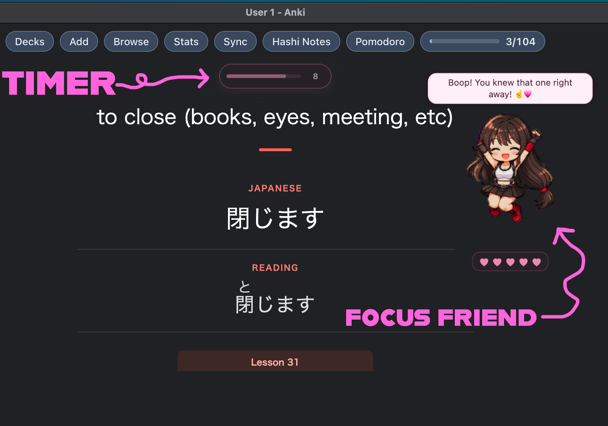</td>
    <td align="center">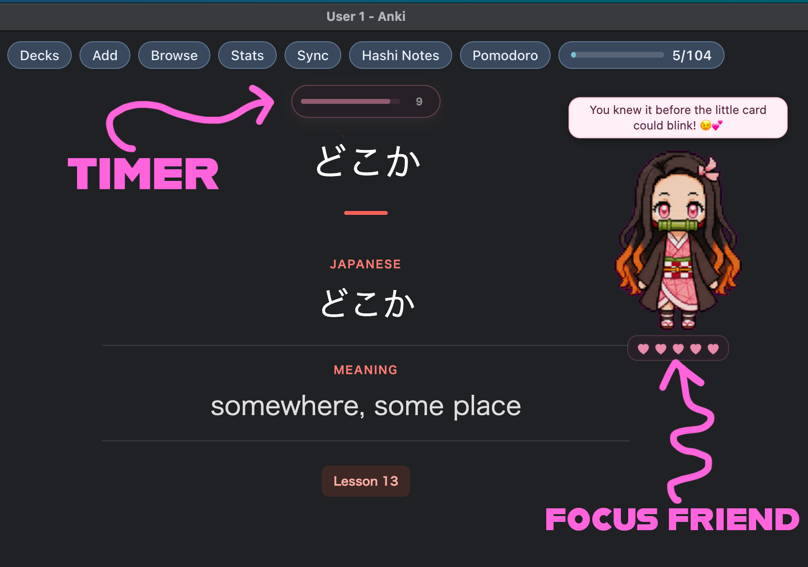</td>
  </tr>
</table>

Your Focus Friend keeps you company while the timer helps you stay with each card. Choose your friend and move them and the timer anywhere. Your layout is remembered separately for each deck.

## Encouragement along the way

Your buddy occasionally offers praise when you remember a card and encouragement when you miss one.

<table>
  <tr>
    <td align="center">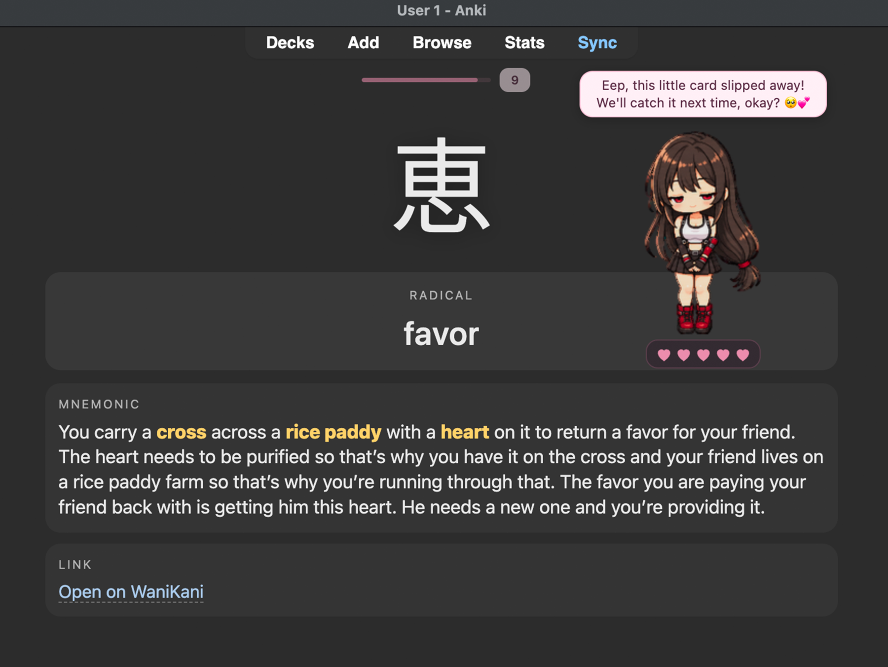 <strong>A missed review</strong></td>
    <td align="center">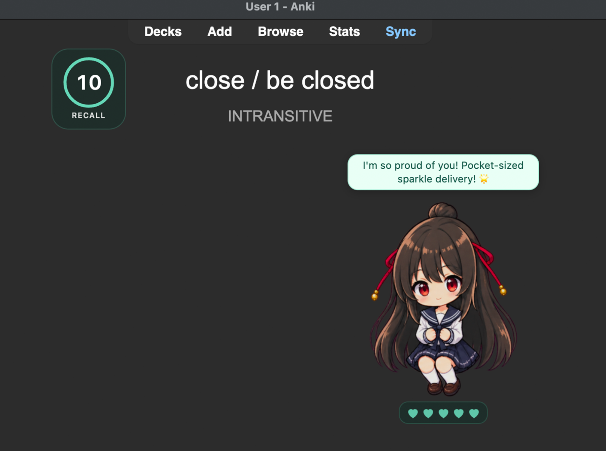 <strong>A correct review</strong></td>
  </tr>
</table>

## Help your buddy recover

If time runs out, complete five later reviews before their timers expire to refill their hearts. The timed-out card itself doesn't count. You can change the recovery length in Settings.

<table>
  <tr>
    <td align="center">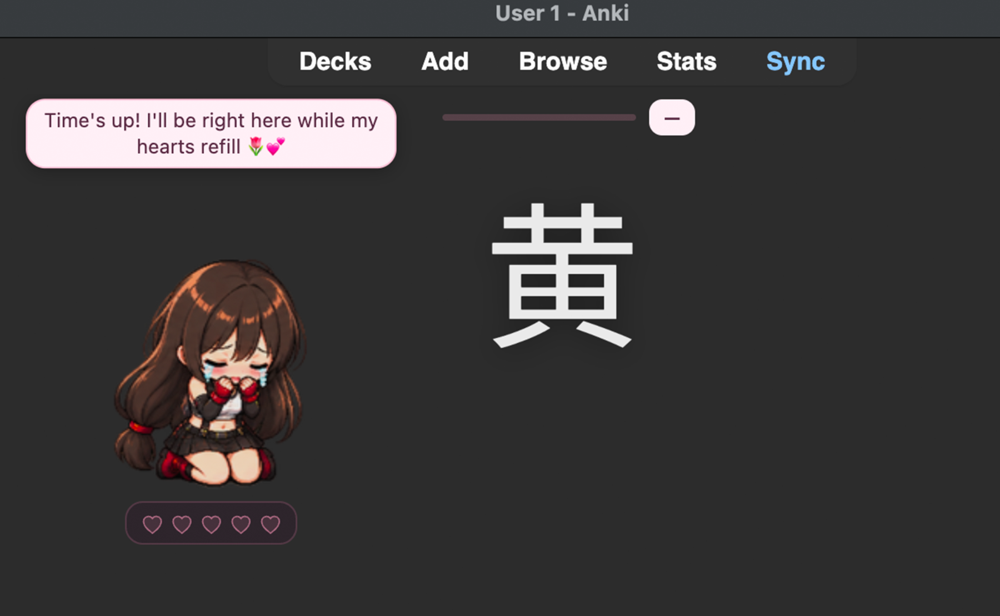 <strong>Just starting</strong></td>
    <td align="center">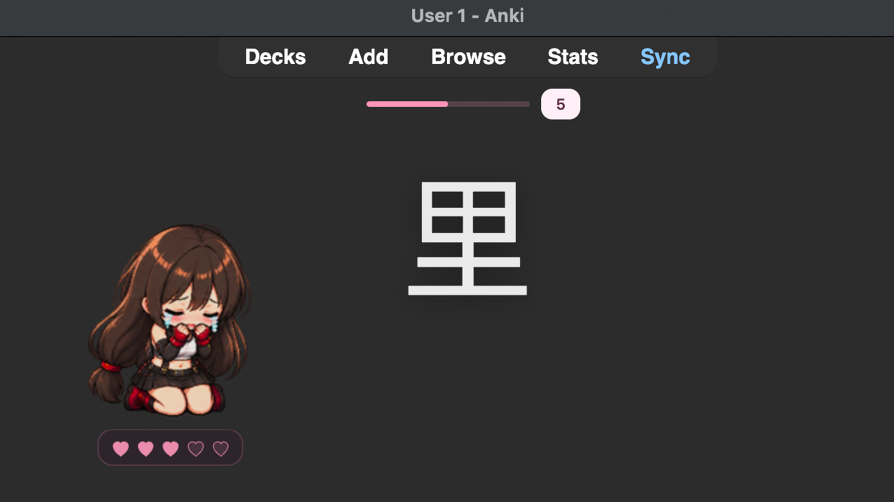 <strong>Halfway there</strong></td>
    <td align="center">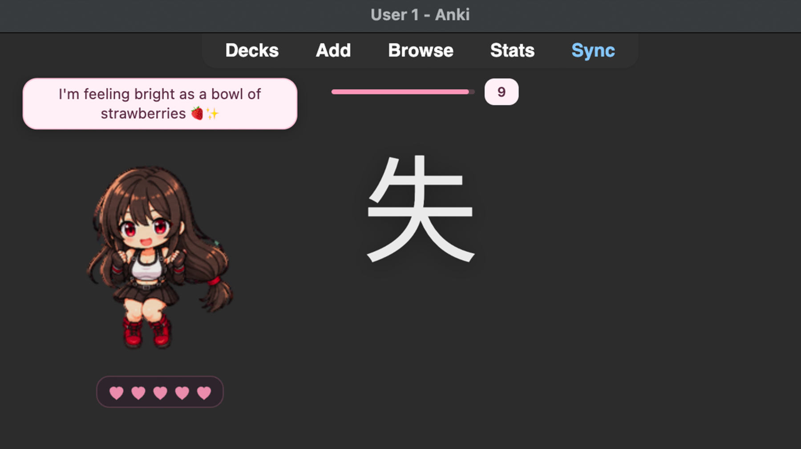 <strong>All better</strong></td>
  </tr>
</table>

## Make it yours

Choose from 15 characters, name your buddy, and move the character and timer anywhere on the screen. Focus Friends remembers their positions separately for each deck, so each deck keeps its own layout. You can also customize timer styles, colors, hearts, and message bubbles.

<table>
  <tr>
    <td align="center">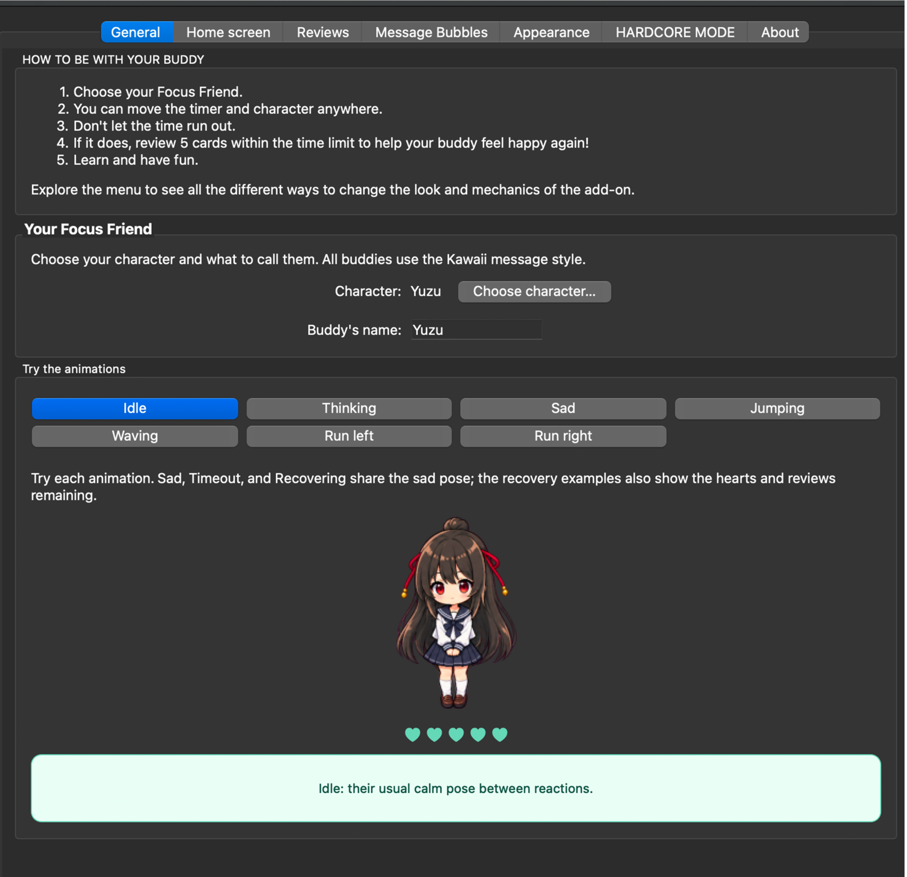 <strong>Pick a buddy and preview their moods</strong></td>
    <td align="center">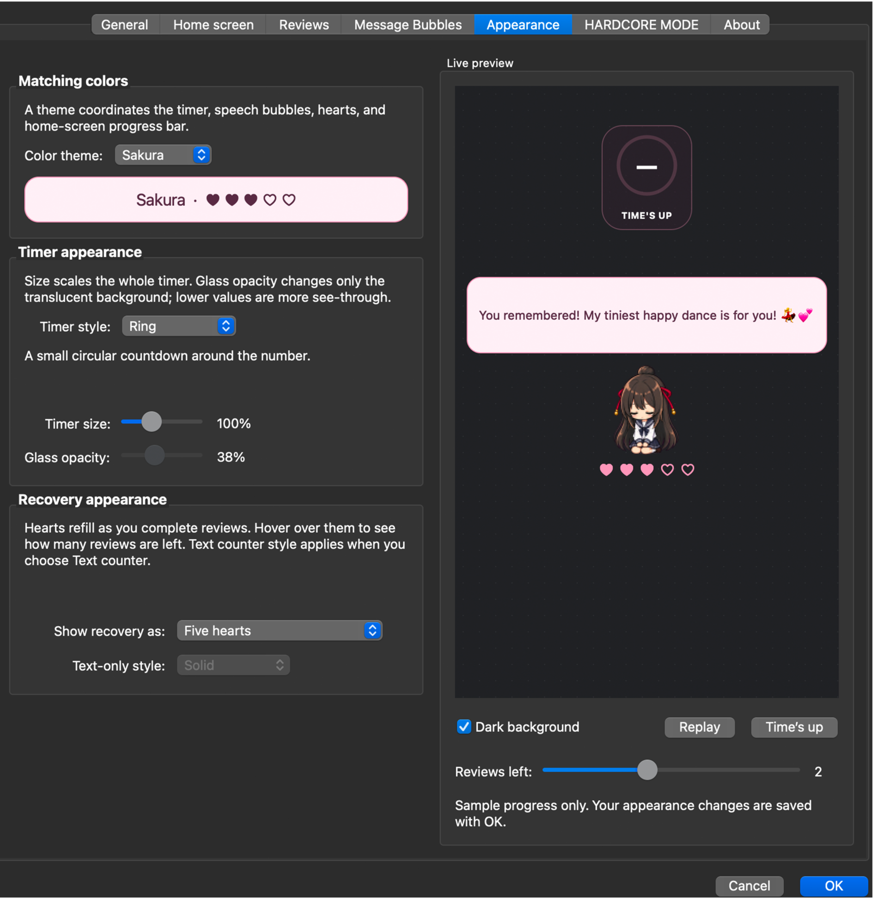 <strong>Try timer and color styles</strong></td>
  </tr>
  <tr>
    <td align="center" colspan="2">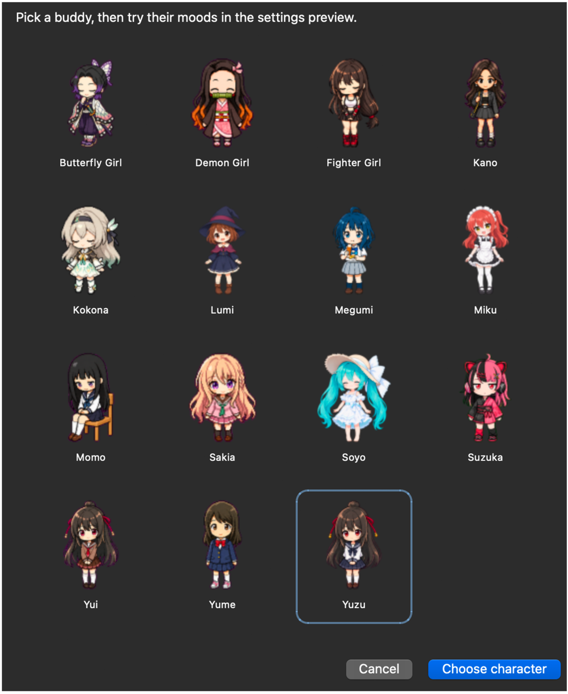 <strong>Choose your character</strong></td>
  </tr>
</table>

## Company between study sessions

Your buddy's home-screen mood changes as your reviews add up. Here Yuzu goes from a few cards to a whole lot of study stars:

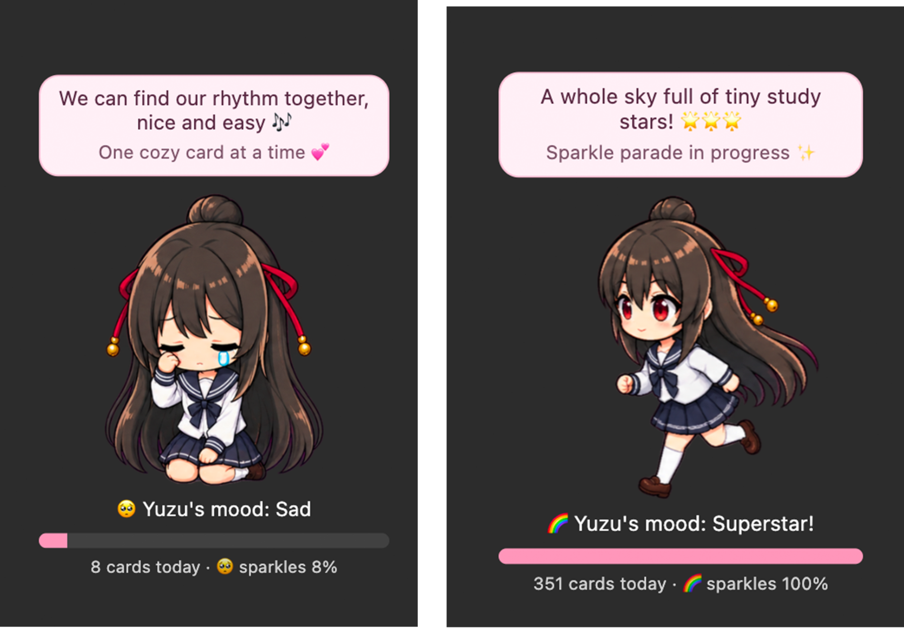

## Install

1. Download the `.ankiaddon` file from the [1.0.0 release](https://github.com/cobeycobb/Focus-Friends/releases/tag/v1.0.0).
2. Open the downloaded file with Anki and restart Anki if prompted.
3. Open **Tools → Focus Friends Settings** to choose your buddy and customize the timer.

Focus Friends is for desktop Anki. The timer and recovery are cosmetic: they don't change card scheduling or ratings. Review tracking stays on your computer. The add-on does not send your review history to a server.

## Credits and license

Animation source links are listed in the add-on's **About** tab. The add-on code is MIT licensed; character artwork retains the terms of its respective sources.
